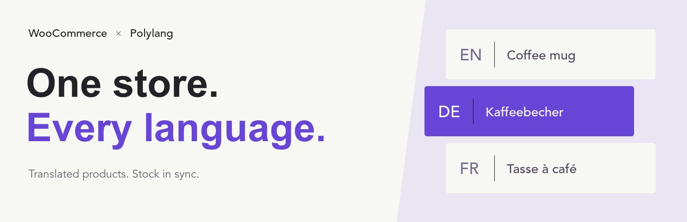

# Hyyan Integration for WooCommerce and Polylang

Build a multilingual WooCommerce store with Polylang. Translate products and store pages, synchronize shared product data, and let customers shop in their chosen language.

Documentation: WordPress admin → Tools → WooPoly Documentation · Getting started: Settings → WooPoly · [Report an issue](https://github.com/hyyan/woo-poly-integration/issues)

## Features

- Translate products, categories, tags, attributes, shipping classes, galleries, and variations.
- Synchronize shared product metadata, stock, and coupons across translations.
- Translate store pages, endpoints, payment and shipping text, and order emails.
- Keep the cart consistent when customers switch languages, including classic and block cart/checkout flows.
- Filter reports by language or combine translated product sales, with legacy and HPOS order storage support.
- Manage integration features and synchronized fields under **Settings → WooPoly**.

## Requirements and compatibility

The plugin requires WordPress 5.4+, PHP 8.3+, WooCommerce 3.0+, and Polylang 2.0+. Your installed dependencies may require newer WordPress or PHP versions.

The current 1.6.0 development checkout has been tested with WordPress 7.1.3, WooCommerce 11.1.2, Polylang 3.8.10, and PHP 8.5.11. Older supported versions have not all been retested. Back up your store and verify updates on a staging site first.

Choose your default language before creating variable products; changing it afterward is unsupported. Polylang's **The language is set from content** URL mode is also unsupported.

## Installation and setup

1. Install this plugin through **Plugins → Add New**, or upload its release ZIP, and activate it. WooCommerce and Polylang can be installed before or afterward.
2. Open **Settings → WooPoly** and follow the checklist to activate dependencies and choose your languages.
3. Create or link your store pages from the checklist, then review their translated content. Existing pages are preserved.
4. Translate product categories and attributes as needed, then create and link product translations.
5. Test product selection, stock, the cart, checkout, and order emails in every store language before going live.

See the bundled guide under Tools → WooPoly Documentation for details.

## Help and contributions

Please use [GitHub issues](https://github.com/hyyan/woo-poly-integration/issues) for bug reports and feature requests. Include your plugin versions, steps to reproduce, and relevant logs with private data removed. See the [contribution guidelines](.github/CONTRIBUTING.md).

Code, documentation, translations, and reproducible bug reports are welcome. See the [testing instructions](.github/CONTRIBUTING.md#running-tests) to get started with local development.

## A note from Hyyan

I started WooPoly in 2015 to help shop owners sell in more than one language. WooPoly has been free from day one. My commitment is to keep it free and open source.

If WooPoly has helped you run your shop, would you [star it on GitHub](https://github.com/hyyan/woo-poly-integration)? It lets me know the work is useful. If you prefer WordPress.org, [a review](https://wordpress.org/support/plugin/woo-poly-integration/reviews/#new-post) about what worked for your store helps the next shop owner decide. Thank you for giving WooPoly a place in your shop.

[Share WooPoly on LinkedIn](https://www.linkedin.com/feed/?shareActive=true&text=%40Hyyan%20Abo%20Fakher%20created%20WooPoly%20in%202015%20to%20connect%20WooCommerce%20with%20Polylang.%20With%20WooPoly%2C%20a%20shop%20can%20list%20the%20same%20product%20in%20several%20languages%20and%20keep%20one%20stock%20count%20across%20all%20its%20translations.%0A%0AHyyan%20made%20WooPoly%20free%20and%20open%20source%20from%20day%20one%20and%20has%20pledged%20to%20keep%20it%20that%20way.%20If%20you%20know%20someone%20building%20a%20multilingual%20store%2C%20pass%20this%20along.%0A%0Ahttps%3A%2F%2Fwordpress.org%2Fplugins%2Fwoo-poly-integration%2F).

— [Hyyan Abo Fakher](https://www.linkedin.com/in/hyyan/)

## Translations

- Arabic by [Hyyan Abo Fakher](https://github.com/hyyan).
- Spanish by [nunhes](https://github.com/nunhes).

## License

[MIT](LICENSE).
