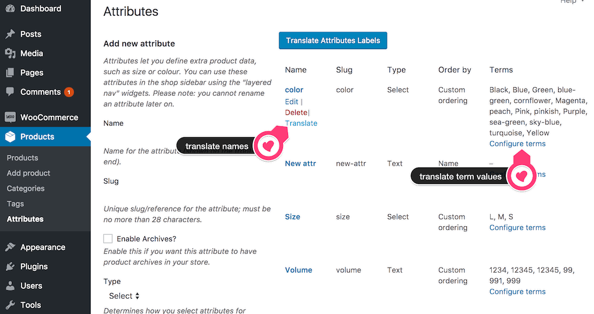
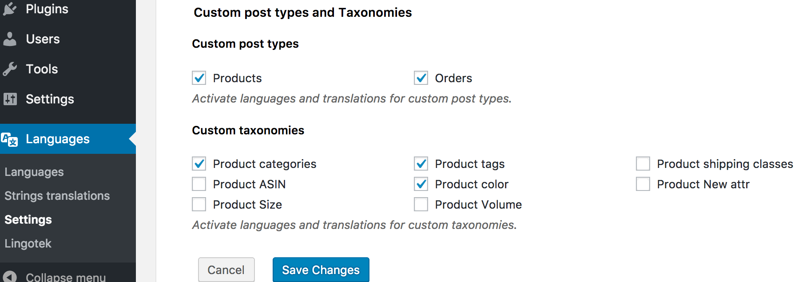

# Product attributes

## Tip - Use Product Attributes

Here's a good tip - use product attributes.  In fact use first categories, tags and the built-in meta fields and then put all the rest of the product data in Product Attributes.

For example:
* Codes like ASIN, ISBN, Numeric style fields like Volume, Net Weight/Product Dimensions (as opposed to the packed size & weight for calculating shipping): these should be Custom Fields, [there are some good tutorials for adding custom fields here](http://www.remicorson.com/mastering-woocommerce-products-custom-fields/). 
* Select fields used for creating product Variations like Colour, Clothing size etc
* Common text fields like Manufacturer, Materials - could be Tag or Product Attribute depending on your use case

Believe us, you don't want all this in your product description, and then have to translate text like Manufacturer etc over and over again for however many hundreds of products you are listing.
Get all the data set up right and translated once, then you just get left with a short description text to translate for each product, which will be quicker and cheaper however you do it.

## How to use Product Attributes 
Product Attributes have a Name which is translatable and a set of Terms which are optionally Translatable.

All Product Attribute Names are added for translation to Polylang [Strings Translations](/translations/strings.md)
In **Languages → Translations**, select the **WooCommerce Attributes** group to translate the attribute names.

Term translation works the same way as the screens for [Product Categories](/products/categories.md) and Tags.

Term translation can be turned on or off for each individual Product Attribute:  attributes are added to Polylang settings page Languages, Settings, Custom post types and Taxonomies `/wp-admin/admin.php?page=mlang_settings`: here you can choose which individual attributes to translate.  For example you have have some attributes which are codes or numeric values which don't need translation, other attributes may be language strings which need to be translated. 

Tips:

- If you don't see the Product attributes here, check that Translate Attributes is enabled  in admin menu [Settings, WooPoly, Features](/settings/features.md), (`/wp-admin/options-general.php?page=hyyan-wpi` Features tab).
- If you set Enable Archives? on the Attribute, each attribute Term becomes a Product Archive page listing the Term, Description and related products: so if this is enabled, this Attribute should be translated so it can find Products in the correct language
- When enabling Translation on an Product Attribute for the first time, you may have terms already existing without translations.  In this case you visit Polylang languages page and follow the prompt to assign items with no language to the default language.  
