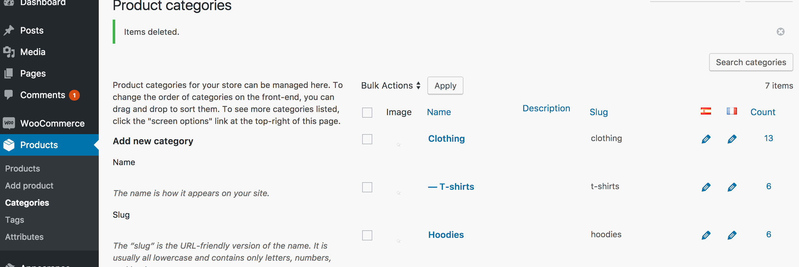

# Product categories

Product Categories and Product Tags are enabled for translation in the same way as Post Categories and Tags.

This is an optional feature, to check it is turned on, visit Settings\WooPoly (normally at /wp-admin/options-general.php?page=hyyan-wpi):

When enabled, these are also shown under Polylang settings (Languages, Settings, Custom post types and Taxonomies)
