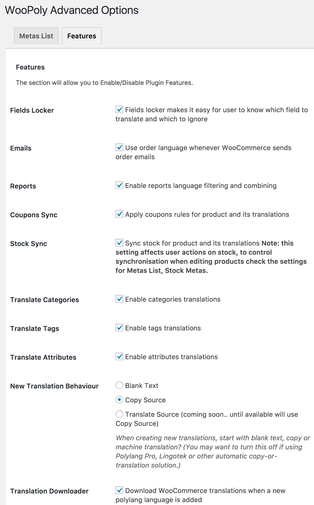

# Features

Available in admin menu Settings, WooPoly, Features, (`/wp-admin/options-general.php?page=hyyan-wpi` Features tab).
See also [Settings, Metas](/settings/metadata.md) 

## Features 

Most of these features should normally be left in the default settings, however they are available for flexibility.
Also you might like to turn on the feature for New Translation Behaviour.

* **Fields Locker**	Depending on your synchronisation settings, certain fields will be copied automatically from base language.  When editing a product in another language the Fields Locker helpfully locks these fields, to make it clear that they should be edited in base language.  [works as of 0.26, javascript performance improved in 1.0]
* **[Emails](/translations/emails.md)**	Disabling this feature turns off the wooCommerce email translation features of this plugin. [v1.0 extends coverage of translatable email types and fields ].  When turned on, any email strings customized in WooCommerce, Settings, Emails become available in Polylang [Strings translations](/translations/strings.md).
* **Reports**	Enable reports language filtering and combining:  if turned off, shows all results, if turned on, use language filter to filter results
* **Coupons Sync**	Apply coupons rules for product and its translations: if On, Usage Restrictions by Products and Categories also apply to the translations of any selected Products and Categories: if off then only the selected terms will be considered
* **[Stock Sync](/products/stock.md)**	Sync stock for product and its translations Note: this setting affects customer actions on stock (impact of basket and orders on stock).  If turned off this setting _may not give expected results_ since Stock Meta may also be synchronised when saving products in the admin screens. To control synchronisation when editing products check the settings for Metas List, Stock Metas.  
**Note: If the Stock Sync is turn off but the Stock Metas sync is left on, then new orders will only affect stock in current language, however if the product is saved then the Stock will be synchronized for all languages again.**
* **Translate [Categories](/products/categories.md)**	Enable translations for Products\Categories:  if turned off the Category titles are the same for all languages.  Highly recommended to leave on and translate.
* **Translate Tags**	Enable translations for Products\Tags: if turned off, tags are available untranslated in all languages. If turned on, Products Tags are translated in the same way as [Product Categories](/products/categories.md) 
* **Translate Attributes**	Enable [Products\Attributes](/products/attributes.md) translations: 
    * **off**: none of the global Products\Attributes in `/wp-admin/edit.php?post_type=product&page=product_attributes` can be translated.
    * **on**: attributes are added to Polylang settings page Languages, Settings, Custom post types and Taxonomies `/wp-admin/admin.php?page=mlang_settings`: here you can choose which individual attributes to translate.  For example you have have some attributes which are codes or numeric values which don't need translation, other attributes may be language strings which need to be translated. 
* **New Translation Behaviour**	When creating new translations, start with blank text, copy or machine translation? (You may want to turn this off if using Polylang Pro, Lingotek or other automatic copy-or-translation solution.)
    * **Blank Text** default behaviour as per previous versions
    * **Copy Source** when creating a new translation, copy from source.  Note that the copy may be based on the current screen, for example if the base language is English you choose for example to create a Spanish translation from within the edit screen for Italian then Italian will be used to create the Spanish version..
    * **Translate Source** currently uses Copy Source. This plugin does not provide automatic machine translation.
* **Use locale number formats** Format prices and other supported numeric values using the locale configured for the current Polylang language. Enabled by default. See [Price localization](/products/price-localization.md).
* **Synchronize on Import** Apply the configured synchronization rules to existing translations when WooCommerce's built-in product importer updates a product. Enabled by default. See [Imports and bulk editing](/products/import-and-bulk-edit.md).
* **Check WooCommerce Pages** Check if WooCommerce pages are present and correctly translated and published. Especially helpful on initial setup. Turn off once setup is complete.
* **Translation Downloader** Download WooCommerce translation files when a new Polylang language is added. Turn off if you manage language packs separately or work without an internet connection. Ensure the WooCommerce language packs are installed for every store language.

