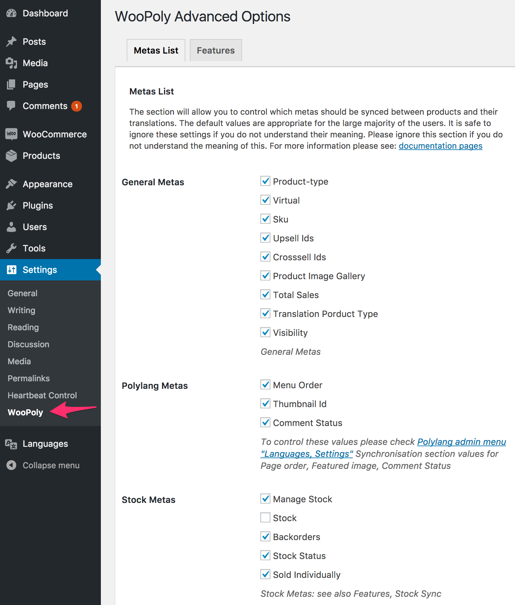
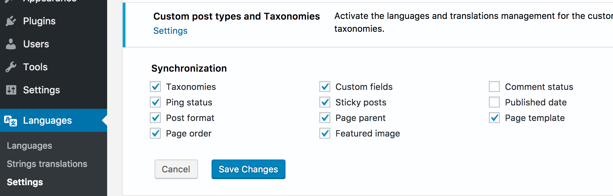
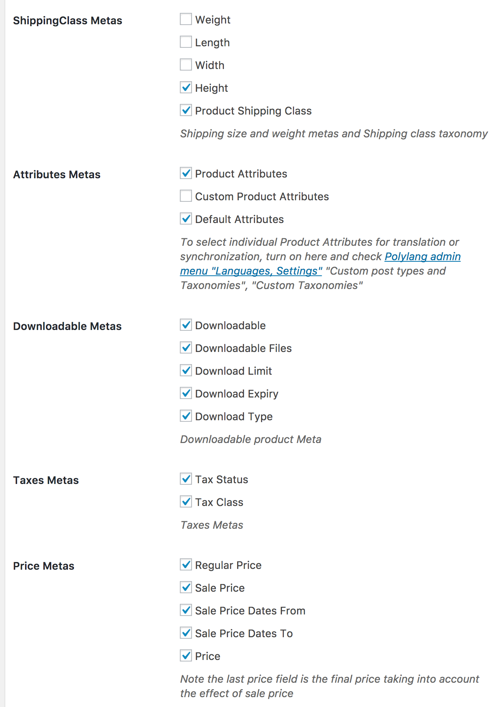

# Metadata synchronization

Available in admin menu Settings, WooPoly, Metas List, (`/wp-admin/options-general.php?page=hyyan-wpi` Metas List tab).
See also [Settings, Features](/settings/features.md) 

Note, this page covers standard WooCommerce Meta information for Products.  For more information on synchronization of other data added by different extension plugins, see [Product Meta and Custom Fields](/products/custom-fields.md).

## Metas List

### General Metas	
* Product-type: leave enabled, should be always be the same in all languages
* Virtual: leave enabled, should be always be the same in all languages
* Sku: Note if this setting is turned off after creating product translations woocommerce will start to give warnings as it now expects the SKU to be unique in each language 
* Upsell Ids: leave enabled: the system will automatically show the Upsell in the right language if/when the translation exists.
* Crosssell Ids: leave enabled: the system will automatically show the Cross-Sell in the right language if/when the translation exists.
* Children: the components of group products: leave enabled to copy to translations, the system will automatically show the Group Components in the right language if/when the translation exists. 
* Product Image Gallery:  normally leave this option on to share the image gallery in each language.  
    * If you want some pictures to be different in each language you can add those pictures to the product description which could contain different images 
    * If you want all pictures to be different in each language then turn off this option and other options for Featured Image synchronization. Polylang also has Settings, Media option for system wide language specific media.  Be aware that's a lot of work and a lot of extra files.
* Total Sales
* Translation Porduct Type: leave, used internally by the system
* Visibility: Product Catalogue Visibility and Featured Product are implemented as one taxonomy in WooCommerce3, so turning this option off will stop synchronisation of both features.

### Polylang Metas	
Note: turning off these features may not have the desired effect: to control these values please check Polylang admin menu "Languages, Settings" Synchronisation section values for Page order, Featured image, Comment Status as the Polylang settings may currently override these.
* Menu Order       (Page order)
* Thumbnail Id     (Featured image)
* Comment Status

### Stock Metas	
See note [Features](/settings/features.md), Stock.  Stock synchronisation can be turned off if both Features\Stock and the Stock Metas are turned off.  These options can be turned off individually but a more normal use case would be to leave them all on or all off.  For example if your products are localized (different packaging, different electrical plug etc for each language) then you might want to manage separate stock inventory for each language.
* Manage Stock
* Stock
* Backorders
* Stock Status
* Low Stock Amount
* Sold Individually
Stock Metas: see also Features, Stock Sync

## Metas List page 2.. scroll on for more Metas

### ShippingClass Metas	
Should normally be left on, so the same size/weight information is available in all languages
* Weight
* Length
* Width
* Height
* Product Shipping Class  (again should normally be left on, shipping price will be determined by shipping calculator based on customer location rather than by language)

### Attributes Metas	
* Product Attributes - the global Products\Attributes are actually enabled for translation in [Settings, Features](/settings/features.md) and then managed in Polylang settings page Languages, Settings, Custom post types and Taxonomies /wp-admin/admin.php?page=mlang_settings
* Custom Product Attributes:  This setting applies to attributes added directly to individual products, as opposed to Products\Attributes which allows attributes and their values or translations to be shared across products/languages.   Note also that the name of the custom attribute can't readily be translated.
    * if *on* all custom attributes will be synchronised from base language
    * if *off* custom attribute value will be initially copied from base language but can be customized. 
* Default Attributes: this option synchronises the default variation for variation products

### Downloadable Metas	
Controls Synchronisation of Meta information for Downloadable products
* Downloadable
* Downloadable Files
* Download Limit
* Download Expiry
* Download Type

### Taxes Metas	
should normally be left on, tax should be driven by country not by language
* Tax Status
* Tax Class

### Price Metas	
Note the last price field is the calculated final price taking into account the effect of sale price.
So for example if you want to have sale prices applying to one language only, then uncheck the Sale Price fields and the Price field.
* Regular Price
* Sale Price
* Sale Price Dates From
* Sale Price Dates To
* Price

## Variables Metas	
Current WooCommerce versions calculate variable-product prices from their variations. The fields below remain in the settings for compatibility with older WooCommerce data.

Detailed price synchronisation control for Variable Products
* Min Variation Price
* Max Variation Price
* Min Price Variation Id
* Max Price Variation Id
* Min Variation Regular Price
* Max Variation Regular Price
* Min Regular Price Variation Id
* Max Regular Price Variation Id
* Min Variation Sale Price
* Max Variation Sale Price
* Min Sale Price Variation Id
* Max Sale Price Variation Id
