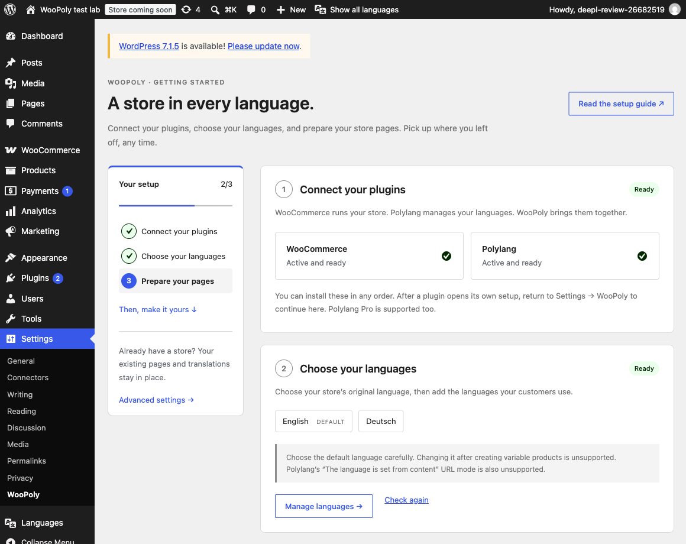
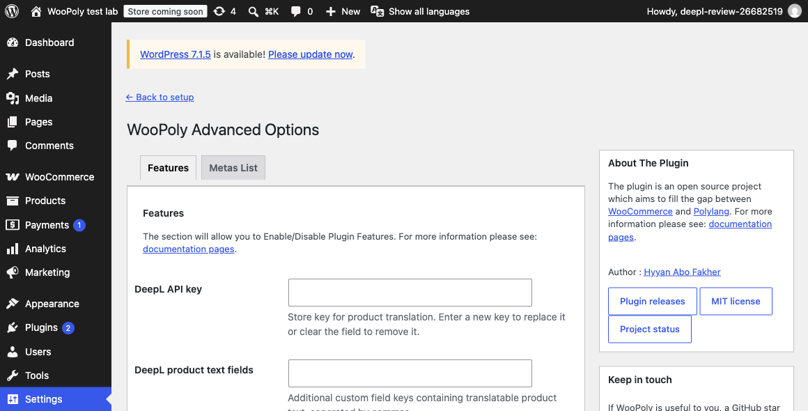
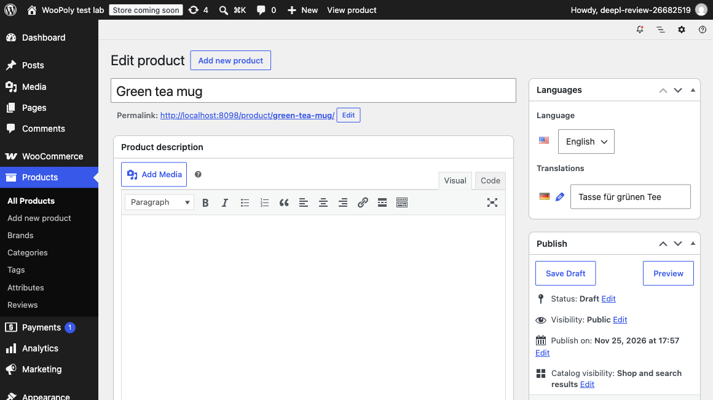
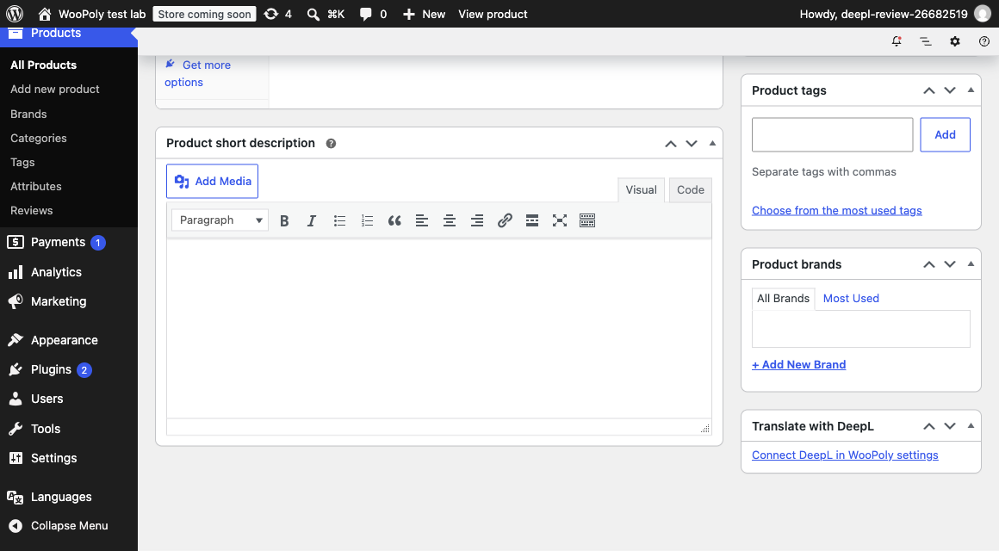
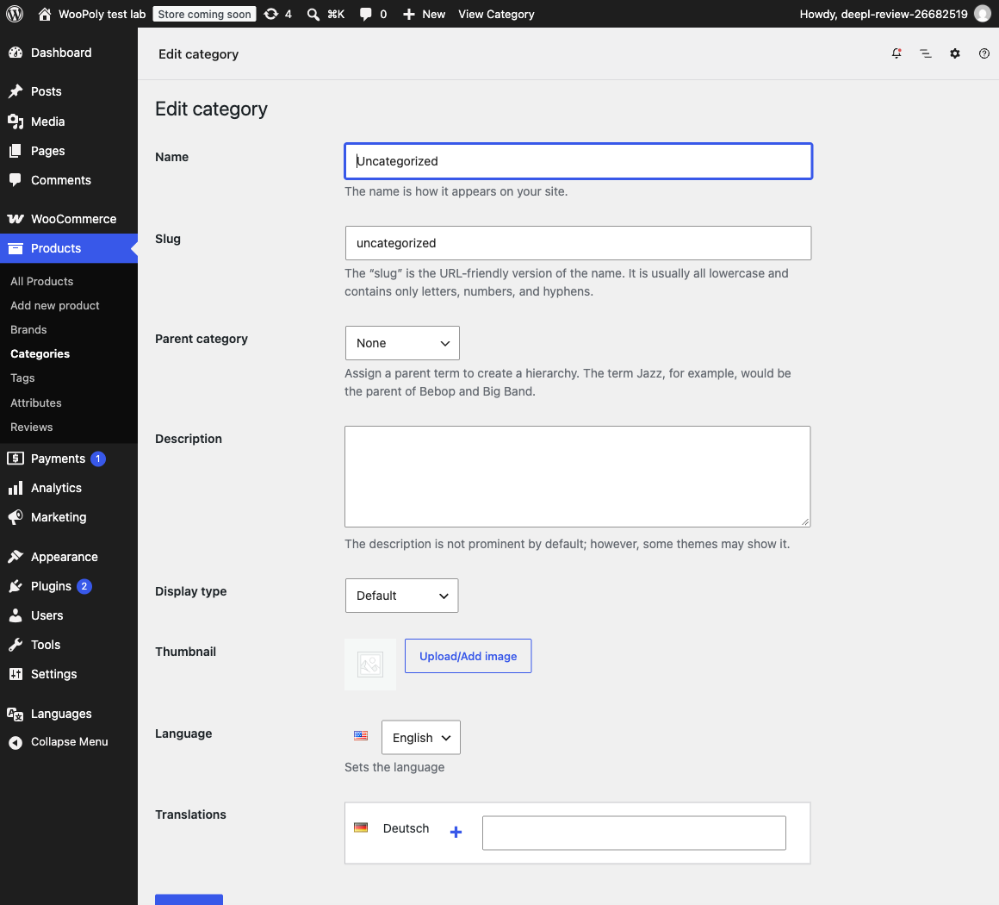

# Translate a product with DeepL

Create a linked draft in another Polylang language from a saved WooCommerce product. For example, an English shirt can have a French draft with **Couleur** and **Rouge** as its variation options while keeping the variation’s SKU, price, and stock quantity.

## Connect a DeepL API key

**1. Find WooPoly in WordPress.** In the dashboard’s left sidebar, open **Settings**, then **WooPoly**. On the WooPoly setup screen, choose **Advanced settings →** at the bottom of the **Your setup** card.



**2. Enter the store key.** On **WooPoly Advanced Options**, select the **Features** tab. Enter your DeepL API Free or Pro key in **DeepL API key**, the first field. Scroll to the bottom of the form and select **Save Changes**. Everyone who can translate products in this store can now use the connection.



The saved key stays hidden. Enter a new key to replace it or clear the field and save to remove it. Stores that supply a key through server configuration continue to use it when the settings field has no saved key.

## Create and review the draft

1. Add the target language in Polylang. Save the original product with its source language assigned. Save any pending edits before translating.
2. Open the product editor with an account that can manage WooCommerce, edit this product, and create products.
3. In **Translate with DeepL**, choose **Target language**, then **Create translated draft**. This sends the saved translatable text to DeepL.
4. The editor opens the linked draft. Review the product text, attribute choices, variation descriptions, and images. Publish when the translation is ready.

If a language is missing from the selector, check the product’s **Languages** panel. When a linked translation already exists, open it there to edit it. WooPoly leaves reviewed translations in place.

In the example below, **Green tea mug** is the English source product. The pencil beside **Tasse für grünen Tee** in the right-hand **Languages** panel opens its German draft.



## What gets translated

| Product data | Draft behavior |
| --- | --- |
| Name, short and full descriptions, purchase note | Text is translated. Descriptions containing HTML are sent using DeepL’s HTML mode. |
| Categories, tags, global attribute terms | Enable translation for the relevant taxonomies in Polylang. Existing translated terms are reused, including manually edited names. Missing translations are created and linked. Assign a source language to any terms you want translated. WooPoly skips terms without a language in translated taxonomies. |
| Attributes and variations | Local attribute names and values, global attribute labels, and variation descriptions can be translated. Review the default selection and each variation in the draft. |
| Product and variation images | With media translation enabled in Polylang, an existing translated attachment is reused. New translated attachments share the image file and have their own caption and alternative text. |
| SEO and custom product text | Select eligible text fields in WooPoly’s settings. Operational fields such as SKU, stock, and price are handled as WooCommerce data. |

## Include custom text fields

Open **Settings → WooPoly → Advanced settings → Features**. In **DeepL product text fields**, enter the stored metadata keys, separated by commas. For example, if your store saves a care instruction under `care_instructions`, enter that key and save the settings before creating the draft. Use the stored key even if the field’s label in the editor is different.

Extensions can register additional keys with the `woo-poly.product.translationMetaKeys` filter, which receives the configured keys and the source product. Only include customer-facing text intended to be sent to DeepL. WooPoly skips structured values and excludes WooCommerce internal fields.

For example, add this to a site-specific plugin to translate the `care_instructions` field on variable products. The callback appends the key to the list from **DeepL product text fields** and returns the list for every product. The final `2` tells WordPress to pass both the keys and the source product to the callback.

```php
add_filter(
	'woo-poly.product.translationMetaKeys',
	function ( $keys, $product ) {
		if ( $product->is_type( 'variable' ) ) {
			$keys[] = 'care_instructions';
		}

		return $keys;
	},
	10,
	2
);
```

## If translation fails

### The editor asks you to connect DeepL

In the product editor, scroll down to **Translate with DeepL** in the right-hand column. Follow **Connect DeepL in WooPoly settings**, then follow the [store key setup steps](#connect-a-deepl-api-key). If your account cannot change store settings, ask a store administrator to connect DeepL. Then reopen the saved product.



### A category is missing from the draft

In the test store, translating a second product with the default **Uncategorized** category previously produced the error “A term with the name provided already exists with this parent.” WooPoly now skips categories without an assigned language, so the product draft can still be created.

To include the category in future translations, open **Products → Categories**, edit the source category, scroll below **Thumbnail** to **Language**, choose the language of the category name, and select **Update**. If the product already has a linked draft, open it and review its categories.



### DeepL rejects the request

Check the account quota and whether DeepL supports the selected language pair. Correct the problem and retry from the saved source product.
