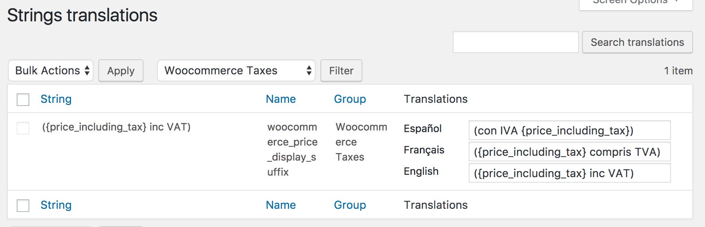

# Translating store text

## Overview

woo-poly-integration adds the following types of strings to the Polylang strings translation table (Languages, Strings translations - normally found at /wp-admin/admin.php?page=mlang_strings)

* **WooCommerce Emails**  When strings are edited in WooCommerce, Settings, Email (/wp-admin/admin.php?page=wc-settings&tab=email) they are added to strings translation table.  Strings that are not edited will use the default translation from the WooCommerce language files.
* **WooCommerce Endpoints**
* **WooCommerce Shipping Methods**  Appears after you set these up in WooCommerce 
* **WooCommerce Taxes** see below
* **WooCommerce Attributes** see below
* **WooCommerce Payment Gateways** After adding a new payment gateway check here for translation options for title and description

## WooCommerce Attributes
In **Languages → Translations**, select the **WooCommerce Attributes** group to translate attribute names.
This section allows the translation of all Attribute names appearing under [Products\Attributes](/products/attributes.md) regardless of whether the attribute values (Terms) are going to be translated. 
For detail on the Term translation options see [Products\Attributes](/products/attributes.md).

## WooCommerce Taxes
If you display tax as part of the price you can now customize how this is translated.  The string includes a parameter for the price so you can display text before or after in different languages for example:
* ({price_including_tax} inc VAT)
* (con IVA {price_including_tax})

